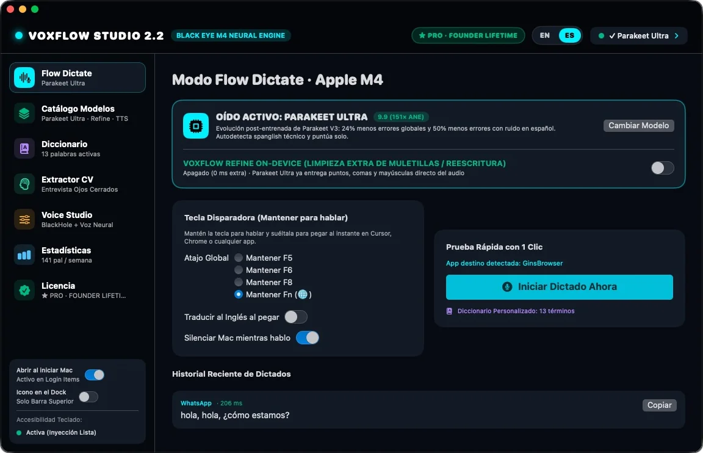

<div align="center">
  
  <br /><br />
  <p><strong>Mantén <kbd>Fn</kbd>. Habla. Suelta. Ya está escrito.</strong></p>
  <p>
    <a href="https://voxflow.iareal.net/es/">Sitio web</a> ·
    <a href="https://voxflow.iareal.net/api/download/latest">Descargar</a> ·
    <a href="SECURITY.md">Seguridad</a> ·
    <a href="README.md">English</a>
  </p>
</div>

# 🎙️ VoxFlow Studio

> Dictado que nunca manda tu voz a ningún lado.

VoxFlow Studio es dictado push-to-talk para Mac con Apple Silicon. Mantén la tecla Fn (🌐), habla con naturalidad y el texto aparece en la app que tengas abierta. La transcripción corre en el Neural Engine de tu Mac, así que tu audio nunca sale del equipo.

Este repositorio aloja el sitio web oficial y la API de licencias. La app de macOS se distribuye como una versión firmada y notarizada.

## ✨ ¿Por qué VoxFlow Studio?

El dictado en la nube cambia privacidad y dinero por comodidad: una suscripción, conexión a internet y una grabación de tu voz en el servidor de otra persona.

VoxFlow se queda con todo el proceso en tu Mac. Los modelos de voz compilados para Core ML corren en local, Apple Intelligence puede pulir el resultado, un diccionario fonético corrige los nombres que de verdad dices y ⌘V se presiona por ti. Descargas el modelo una vez y el dictado funciona sin internet. Pagas una vez y la licencia es tuya.

## 📲 Descargar

**[→ Descargar VoxFlow Studio para macOS](https://voxflow.iareal.net/api/download/latest)**

Última versión **2.4.2** · firmada con Developer ID y notarizada por Apple · Team ID `YH6W55MP95`

```
SHA-256  60df6f84f14a6557215cf4f57a03d23c6ad292571e9c92c869777f30f0ab7e3b
```

**Requisitos**

- Mac con Apple Silicon (M1 o posterior)
- macOS 15 o posterior
- Refine necesita macOS 26 con Apple Intelligence activado
- Una descarga de modelo: 220 MB (Redux) a 595 MB (Ultra); después el dictado funciona sin conexión

**Instalación**

1. Descarga el `.dmg` y ábrelo.
2. Arrastra **VoxFlow Studio** a **Aplicaciones**.
3. Abre la app y concede **Accesibilidad** cuando macOS la pida. Es la forma en que una app de Mac detecta tu tecla global y presiona ⌘V en otra app; VoxFlow no lee tu pantalla ni registra lo que escribes.
4. Elige un modelo de voz y mantén **Fn (🌐)**. Eso es todo.

**Verifica la descarga**

```bash
shasum -a 256 ~/Downloads/VoxFlowStudio-2.4.2.dmg
```

**Prueba y precios**

Todas las funciones son gratis durante **14 días, sin tarjeta**. El día 15 la tecla de dictado se desactiva hasta que introduzcas una licencia; tu diccionario, historial y estadísticas se quedan intactos.

- **Personal** — $29 una vez, 1 Mac
- **Pro** — $49 una vez, 3 Macs
- **Team** — $69 una vez, 5 Macs

Todas las licencias son de por vida e incluyen actualizaciones 2.x firmadas. Precios en USD.

## 🚀 Cómo funciona

1. **Instala y abre VoxFlow Studio.** Déjalo en Aplicaciones.
2. **Descarga un modelo una vez.** Parakeet Ultra detecta español e inglés solo; V3 cubre 25 idiomas; Redux es el más pequeño; V2 es solo inglés; Apple Speech viene con macOS. Después todo corre en local.
3. **Mantén Fn (🌐) y habla.** Fn está debajo de tu meñique izquierdo en cualquier teclado Mac. Puedes cambiar el disparador a F5, F6 o F8.
4. **Suelta.** VoxFlow transcribe en el Neural Engine y pega el texto en la app que tengas al frente.
5. **Sigue escribiendo.** Tu portapapeles anterior vuelve y el dictado queda en tu historial local.

**El medio segundo después de soltar**

- El micrófono sigue abierto 55 ms más para que no se corte tu última consonante.
- Las pulsaciones de menos de 120 ms de audio (1.920 muestras a 16 kHz), o de puro silencio, se descartan en vez de pegarse.
- Si Refine está activo, tiene 1,6 segundos. Una respuesta más lenta, o que conteste como un chatbot, se rechaza y se pegan tus propias palabras.
- ⌘V sale de una fuente de eventos privada mientras todavía estás soltando Fn, y tu portapapeles vuelve 450 ms después.



## 📖 Guías

- **[Sitio web y preguntas frecuentes](https://voxflow.iareal.net/es/#faq)** — precios, permisos, uso sin internet, español e inglés mezclados.
- **[Cómo funciona el dictado](https://voxflow.iareal.net/es/#how)** — el recorrido en vivo del sitio.
- **[Pantallas de la app](https://voxflow.iareal.net/es/#tour)** — cada pantalla, en inglés y español.
- **[Política de seguridad](SECURITY.md)** — cabeceras, endurecimiento del contenedor, manejo de secretos y criptografía de licencias.
- **Guía para desarrolladores** — compilar, configurar y desplegar este repositorio, más abajo.

### Para desarrolladores

Requisitos: Node.js 22 y npm.

```bash
npm ci
npm run dev            # http://localhost:5173 y /es/
npm run build          # typecheck + prerender + vite build → dist/
npm run build:preview  # un solo HTML autocontenido
npm start              # servidor Node + API en el puerto 8080
```

El sitio es HTML prerenderizado con un cliente Vite. El inglés está en `/` y el español en `/es/`; `src/config/funnel.ts` guarda los precios, enlaces, metadatos de descarga y todos los textos en ambos idiomas. `scripts/prerender.ts` escribe las dos páginas, el sitemap y robots.txt. El build de producción no incluye sourcemaps.

El servidor Node de `server/` sirve `dist/` y expone la API de la tienda:

- `GET /api/health`, `GET /api/updates/latest`, `GET /api/download/latest`
- `GET /api/checkout?tier=personal|pro|team`
- `POST /api/webhooks/stripe`
- `POST /api/trial/start`, `POST /api/trial/verify`
- `POST /api/license/activate`, `/status`, `/deactivate`
- `GET /admin` — Google OAuth, con control de acceso en el servidor

La configuración vive solo en variables de entorno. El servidor lee `DATABASE_URL` (o `APP_VOXFLOW_DATABASE_URL`), `NEXT_PUBLIC_APP_URL`, `N8N_PAYMENT_URL`, `N8N_EMAIL_URL`, `EMAIL_FROM`, `STORAGE_LOCAL_DIR`, `STRIPE_SECRET_KEY`, `VOXFLOW_ED25519_PRIVATE_KEY`, `VOXFLOW_ED25519_PUBLIC_KEY`, `GOOGLE_CLIENT_ID`, `GOOGLE_CLIENT_SECRET`, `ADMIN_ALLOWED_EMAILS` y `AUTH_SECRET`. `SITE_URL` se pasa en build para canonical, hreflang y Open Graph. Nunca subas sus valores al repositorio.

El despliegue usa `Dockerfile` y `docker-compose.yaml` (Coolify, puerto 8080, volumen `/app/storage` para releases, sistema de archivos de solo lectura). `docker-compose.yaml` publica `127.0.0.1:3049:8080`. El healthcheck es `GET /api/health`.

## 🔧 Funciones

**Dictado**

- Push-to-talk global con Fn (🌐); F5, F6 y F8 como alternativas.
- Pega con ⌘V desde una fuente de eventos privada, para que la tecla Fn que estás soltando no lo convierta en otro atajo.
- 55 ms de cola de audio, mínimo de 120 ms contra pulsaciones accidentales y descarte de silencio.
- Silencio automático por CoreAudio mientras hablas, con el volumen y el mute exactos restaurados.
- Portapapeles restaurado 450 ms después de pegar.
- Historial de dictados en local.

**Modelos en el dispositivo**

- Cuatro modelos Parakeet compilados para Core ML: Ultra (595 MB, español e inglés automáticos), V3 (480 MB, 25 idiomas), Redux (220 MB, ultra ligero), V2 (474 MB, solo inglés).
- Apple Speech como alternativa sin descarga.
- Se descargan una vez y después todo funciona sin conexión.

**Limpieza y traducción**

- Refine opcional con Apple Intelligence y FoundationModels: puntuación, muletillas fuera, sin RAM extra.
- Límite estricto de 1,6 s y guardia anti-chatbot; si se agota el tiempo o la respuesta suena a chat, se pega la transcripción original.
- Traducción al inglés al pegar.
- Conectores BYOK opcionales: Groq, OpenAI u Ollama local.

**Diccionario**

- Alias exactos y coincidencia fonética para marcas, frameworks, siglas y spanglish.
- Corre en memoria de forma determinista en menos de 1 ms, antes de que el texto llegue a tu app.

**Privacidad e integración con el sistema**

- El audio, la transcripción, el diccionario y las estadísticas se quedan en la Mac.
- El permiso de Accesibilidad se usa solo para la tecla global y el pegado; no lee la pantalla ni registra pulsaciones.
- Estadísticas en un archivo local: palabras por día, ritmo, rachas, horas pico y apps de destino.
- Builds firmados y notarizados; Team ID `YH6W55MP95`.
- Licencia Ed25519 verificada sin conexión, con activación y desactivación entre Macs.

**Licencias y actualizaciones**

- Licencias de por vida Personal (1 Mac), Pro (3 Macs) y Team (5 Macs).
- Actualizaciones 2.x firmadas.
- Prueba de 14 días con todas las funciones.

**Este repositorio**

- Tienda bilingüe prerenderizada (EN `/`, ES `/es/`) con hreflang, JSON-LD, imágenes Open Graph por idioma, sitemap y robots.
- Redirección por país a `/es/` para países hispanohablantes, anulable con la cookie `voxflow-lang`.
- Pago a través del gateway n8n, con respaldo directo de Stripe.
- Emisión de licencias Ed25519, control de asientos en Postgres y anclaje firmado del periodo de prueba.
- Panel de administración en `/admin`, con control de acceso en el servidor y Google OAuth.
- Build de preview en un solo archivo para revisión offline.
- Contenedor endurecido: sistema de archivos de solo lectura, capabilities eliminadas, usuario no root.

## ❓ ¿Nuevo en GitHub?

No necesitas GitHub para instalar VoxFlow Studio, y este repositorio no tiene Releases públicos.

1. Abre **[voxflow.iareal.net/es](https://voxflow.iareal.net/es/)**.
2. Deja tu email y la descarga empieza; el mismo enlace llega por correo.
3. Abre `VoxFlowStudio-2.4.2.dmg` y arrastra la app a Aplicaciones.
4. En el primer arranque, concede Accesibilidad para que funcionen la tecla Fn y el pegado.
5. Mantén Fn y habla.

Si ya tienes el repositorio: `npm ci && npm run build`, y después `npm start`.

## 📙 Contribuir

VoxFlow Studio es software propietario. Este repositorio es público, pero no se aceptan pull requests externos. Si encuentras un problema de seguridad, lee [SECURITY.md](SECURITY.md) y escribe a **voxflow@iareal.net** en vez de abrir un issue público. Para licencias, cambios de asiento o reembolsos, usa la misma dirección.

## ❗ Acerca de

VoxFlow Studio lo desarrolla **BLACK EYE**, un estudio independiente de software para Mac. Este repositorio contiene el sitio web oficial y el backend de licencias; el código de la app de macOS se mantiene en privado.

Las capturas de `public/screens/` vienen de la app VoxFlow Studio y se usan en el sitio en ambos idiomas. La interfaz está disponible en inglés y español, y el sitio sigue la misma división.

Apple, macOS, Apple Silicon, Apple Intelligence y la tecla Fn/Globo son términos de Apple Inc. VoxFlow Studio no está afiliada a Apple.

## 📜 Licencia

**Propietaria. Todos los derechos reservados.**

Este repositorio no tiene licencia de código abierto. El código, los textos, las capturas y los recursos de marca son propiedad de BLACK EYE. No se concede permiso para copiar, redistribuir, sublicenciar ni crear obras derivadas sin consentimiento previo por escrito.

Las dependencias de terceros conservan sus propias licencias (Vite, TypeScript, Three.js, node-postgres). Las versiones exactas están en `package-lock.json`.
