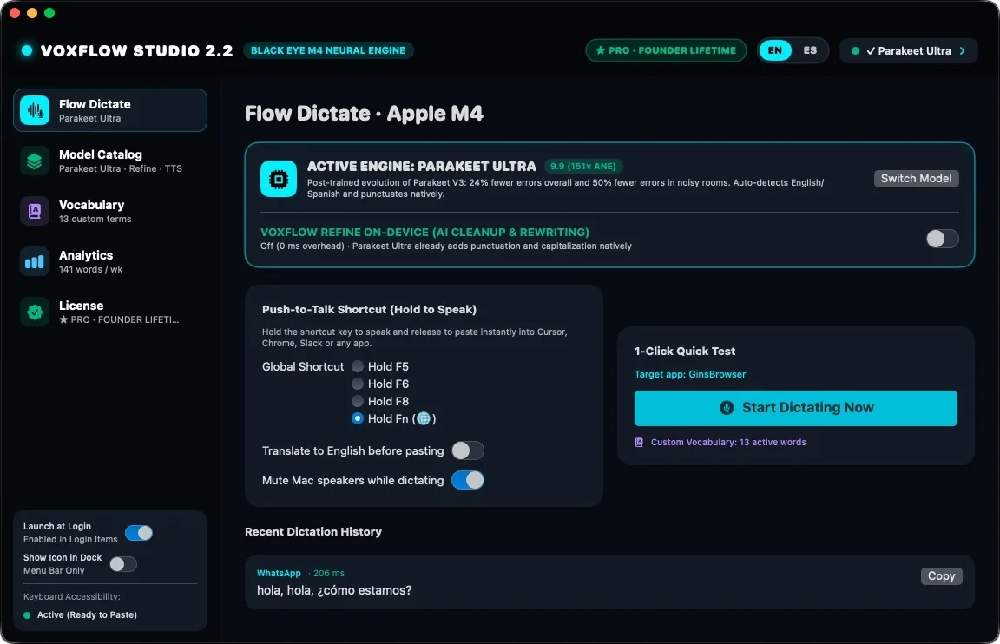

<div align="center">
  
  <br /><br />
  <p><strong>Hold <kbd>Fn</kbd>. Talk. Let go. It's typed.</strong></p>
  <p>
    <a href="https://voxflow.iareal.net">Website</a> ·
    <a href="https://voxflow.iareal.net/api/download/latest">Download</a> ·
    <a href="SECURITY.md">Security</a> ·
    <a href="README.es.md">Español</a>
  </p>
</div>

# 🎙️ VoxFlow Studio

> Dictation that never sends your voice anywhere.

VoxFlow Studio is push-to-talk dictation for Apple Silicon Macs. Hold the Fn (🌐) key, speak naturally, and the text appears in whatever app you are using. Transcription runs on your Mac's Neural Engine, so your audio never leaves the machine.

This repository hosts the official website and licensing API. The macOS app is distributed as a signed, notarized build.

## ✨ Why VoxFlow Studio?

Cloud dictation trades privacy and money for convenience: a subscription, a network connection and a recording of your voice on someone else's server.

VoxFlow keeps the whole loop on your Mac. Speech models compiled for Core ML run locally, Apple Intelligence can clean up the result, a phonetic dictionary fixes the names you actually say, and ⌘V is pressed for you. Download the model once and dictation works offline. Pay once and the license is yours.

## 📲 Download

**[→ Download VoxFlow Studio for macOS](https://voxflow.iareal.net/api/download/latest)**

Latest release **2.4.2** · signed with a Developer ID and notarized by Apple · Team ID `YH6W55MP95`

```
SHA-256  60df6f84f14a6557215cf4f57a03d23c6ad292571e9c92c869777f30f0ab7e3b
```

**Requirements**

- Mac with Apple Silicon (M1 or later)
- macOS 15 or later
- Refine needs macOS 26 with Apple Intelligence enabled
- One model download: 220 MB (Redux) to 595 MB (Ultra); dictation then runs offline

**Install**

1. Download the `.dmg` and open it.
2. Drag **VoxFlow Studio** into **Applications**.
3. Open the app and allow **Accessibility** access when macOS asks. It is how a Mac app detects your global trigger key and presses ⌘V in another app; VoxFlow does not read your screen or log your keystrokes.
4. Pick a speech model and hold **Fn (🌐)**. That's it.

**Verify the download**

```bash
shasum -a 256 ~/Downloads/VoxFlowStudio-2.4.2.dmg
```

**Trial and pricing**

Every feature is free for **14 days, no card**. On day 15 the dictation key stops until you enter a license; your vocabulary, history and stats stay untouched.

- **Personal** — $29 once, 1 Mac
- **Pro** — $49 once, 3 Macs
- **Team** — $69 once, 5 Macs

All licenses are lifetime and include signed 2.x auto-updates. Prices in USD.

## 🚀 How it works

1. **Install and open VoxFlow Studio.** Keep it in Applications.
2. **Download a model once.** Parakeet Ultra detects Spanish and English automatically; V3 covers 25 languages; Redux is the smallest; V2 is English-only; Apple Speech ships with macOS. Everything runs locally after that.
3. **Hold Fn (🌐) and speak.** Fn sits under your left pinky on every Mac keyboard. You can switch the trigger to F5, F6 or F8.
4. **Let go.** VoxFlow transcribes on the Neural Engine and pastes the text into the app in front of you.
5. **Keep typing.** Your previous clipboard is restored, and the dictation is saved to your local history.

**The half second after you let go**

- The mic stays open 55 ms longer, so your last consonant is not clipped.
- Taps under 120 ms of audio (1,920 samples at 16 kHz), or pure silence, are discarded instead of pasted.
- If Refine is on, it gets 1.6 seconds. A slower answer, or one that replies like a chatbot, is rejected and your own words are pasted.
- ⌘V comes from a private event source while the Fn key is still lifting, and your clipboard comes back 450 ms later.



## 📖 Guides

- **[Website and FAQ](https://voxflow.iareal.net/#faq)** — pricing, permissions, offline use, mixed Spanish and English.
- **[How dictation works](https://voxflow.iareal.net/#how)** — the live walkthrough on the site.
- **[App screens](https://voxflow.iareal.net/#tour)** — every screen, in English and Spanish.
- **[Security policy](SECURITY.md)** — headers, container hardening, secret handling and license cryptography.
- **Developer guide** — build, configure and deploy this repository, below.

### For developers

Requirements: Node.js 22 and npm.

```bash
npm ci
npm run dev            # http://localhost:5173 and /es/
npm run build          # typecheck + prerender + vite build → dist/
npm run build:preview  # one self-contained HTML file
npm start              # Node server + API on port 8080
```

The site is prerendered HTML with a Vite client. English lives at `/` and Spanish at `/es/`; `src/config/funnel.ts` holds the pricing, links, download metadata and every string in both languages. `scripts/prerender.ts` writes both pages, the sitemap and robots.txt. Production builds ship without sourcemaps.

The Node server in `server/` serves `dist/` and exposes the storefront API:

- `GET /api/health`, `GET /api/updates/latest`, `GET /api/download/latest`
- `GET /api/checkout?tier=personal|pro|team`
- `POST /api/webhooks/stripe`
- `POST /api/trial/start`, `POST /api/trial/verify`
- `POST /api/license/activate`, `/status`, `/deactivate`
- `GET /admin` — Google OAuth, gated on the server

Configuration is environment-only. The server reads `DATABASE_URL` (or `APP_VOXFLOW_DATABASE_URL`), `NEXT_PUBLIC_APP_URL`, `N8N_PAYMENT_URL`, `N8N_EMAIL_URL`, `EMAIL_FROM`, `STORAGE_LOCAL_DIR`, `STRIPE_SECRET_KEY`, `VOXFLOW_ED25519_PRIVATE_KEY`, `VOXFLOW_ED25519_PUBLIC_KEY`, `GOOGLE_CLIENT_ID`, `GOOGLE_CLIENT_SECRET`, `ADMIN_ALLOWED_EMAILS` and `AUTH_SECRET`. `SITE_URL` is passed at build time for canonical, hreflang and Open Graph. Never commit their values.

Deployment uses the included `Dockerfile` and `docker-compose.yaml` (Coolify, port 8080, `/app/storage` volume for releases, read-only root filesystem). `docker-compose.yaml` publishes `127.0.0.1:3049:8080`. The healthcheck is `GET /api/health`.

## 🔧 Features

**Dictation**

- Global hold-to-talk on Fn (🌐); F5, F6 and F8 as alternatives.
- Pastes with ⌘V from a private event source, so the Fn key you are releasing cannot turn it into another shortcut.
- 55 ms audio tail, 120 ms accidental-tap floor, silence rejection.
- CoreAudio auto-mute while you talk, with the exact volume and mute state restored.
- Clipboard restored 450 ms after pasting.
- Local dictation history.

**On-device models**

- Four Parakeet models compiled for Core ML: Ultra (595 MB, Spanish and English auto-detected), V3 (480 MB, 25 languages), Redux (220 MB, ultra light), V2 (474 MB, English only).
- Apple Speech as a zero-download fallback.
- Downloaded once, then fully offline.

**Cleanup and translation**

- Optional Refine with Apple Intelligence and FoundationModels: punctuation, filler removal, no extra RAM.
- Hard 1.6 s deadline and anti-chatbot guard; on timeout or a chat-style reply, the raw transcription is pasted.
- Translate to English on paste.
- Optional BYOK connectors: Groq, OpenAI or a local Ollama.

**Vocabulary**

- Exact aliases and phonetic matching for brands, frameworks, acronyms and Spanglish.
- Runs deterministically in memory in under 1 ms, before the text reaches your app.

**Privacy and system integration**

- Audio, transcription, vocabulary matching and statistics stay on the Mac.
- Accessibility permission is used only for the global trigger and the paste; no screen reading or keystroke logging.
- Stats stored in a local file: words per day, pace, streaks, peak hours, target apps.
- Signed, notarized builds; Team ID `YH6W55MP95`.
- Ed25519 license verified offline, with activate and deactivate across Macs.

**Licensing and updates**

- Personal (1 Mac), Pro (3 Macs) and Team (5 Macs) lifetime licenses.
- Signed 2.x auto-updates.
- 14-day trial with every feature.

**This repository**

- Bilingual, prerendered storefront (EN `/`, ES `/es/`) with hreflang, JSON-LD, per-locale Open Graph images, sitemap and robots.
- Country-based redirect to `/es/` for Spanish-speaking countries, overridable by the `voxflow-lang` cookie.
- Checkout through the n8n payment gateway, with a direct Stripe fallback.
- Ed25519 license issuance, seat tracking in Postgres and signed trial anchoring.
- Server-gated admin at `/admin` with Google OAuth.
- Single-file preview build for offline review.
- Hardened container: read-only filesystem, dropped capabilities, non-root user.

## ❓ New to GitHub?

You don't need GitHub to install VoxFlow Studio, and this repository has no public Releases.

1. Open **[voxflow.iareal.net](https://voxflow.iareal.net)**.
2. Enter your email and the download starts; the same link arrives by mail.
3. Open `VoxFlowStudio-2.4.2.dmg` and drag the app to Applications.
4. On first launch, allow Accessibility so the Fn key and the paste work.
5. Hold Fn and speak.

If you already have the repository: `npm ci && npm run build`, then `npm start`.

## 📙 Contributing

VoxFlow Studio is proprietary software. This repository is public, but external pull requests are not accepted. If you find a security issue, read [SECURITY.md](SECURITY.md) and write to **voxflow@iareal.net** instead of opening a public issue. For licensing, seat changes or refunds, use the same address.

## ❗ About

VoxFlow Studio is built by **BLACK EYE**, an independent Mac software studio. This repository contains the official website and the licensing backend; the macOS app source is maintained privately.

The screenshots in `public/screens/` come from the VoxFlow Studio app and are used across the site in both languages. The interface is available in English and Spanish, and the site follows the same split.

Apple, macOS, Apple Silicon, Apple Intelligence and the Fn/Globe key are terms of Apple Inc. VoxFlow Studio is not affiliated with Apple.

## 📜 License

**Proprietary. All rights reserved.**

There is no open-source license for this repository. The code, copy, screenshots and brand assets are the property of BLACK EYE. No permission is granted to copy, redistribute, sublicense or create derivative works without prior written consent.

Third-party dependencies keep their own licenses (Vite, TypeScript, Three.js, node-postgres). See `package-lock.json` for exact versions.
